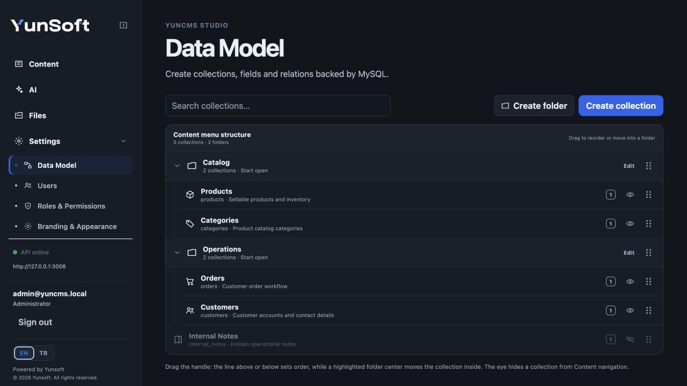

# Data Model Guide

YunCMS stores project content in MySQL collections. A collection has a stable API/database key, a human-readable display name, fields and optional relations. Studio's **Data Model** screen is the normal place to build and maintain this structure; the same operations are also available through the schema REST API.



## Understand the Data Model workspace

Open **Data Model** from the Studio application rail. The workspace keeps collection navigation beside the active schema view so you can move between collection settings, fields, relations and the read-only schema graph without returning to a dashboard.

The collection navigation supports:

- **Create collection** to add a MySQL-backed project collection;
- project and system collection groups;
- collection icons and human-readable display names;
- visibility metadata for Content navigation;
- ordering and presentation metadata;
- access to fields, relations and collection settings.

The navigation editor also supports one-level presentation folders. Folders affect Studio navigation only; they do not create database tables or relations.

Dragging near the top or bottom edge of a row changes order. Dropping over the highlighted center of a folder moves the collection into that folder. The helper text under the navigation editor summarizes the same behavior in Studio.

Folders, order and visibility are interface metadata. They never grant data access; Roles & Permissions remains authoritative.

## Collection names and API keys

Keep the human label separate from the machine key:

```json
{
  "name": "Customer Requests",
  "collection": "customer_requests"
}
```

`name` is what people see in Studio. `collection` is the stable identifier used by REST URLs, permissions, extensions and MySQL. Renaming the display name does not rename the API key or table.

A collection can also carry a note, navigation/display metadata, visibility settings and selected system fields.

## Create a collection in Studio

1. Open **Data Model**.
2. Choose **New collection**.
3. Enter a display name and confirm or edit the generated API key.
4. Select any system fields you want YunCMS to maintain automatically.
5. Create the collection, then add normal fields and relations.

After creation, use the collection navigation when you want to change order, grouping or Content visibility. Open the collection itself when you want to change fields, relations or collection settings.

Use stable lowercase API keys such as `orders`, `customer_requests` and `invoice_lines`. Treat an API key as part of your integration contract after external applications begin using it.

## Fields in Studio

The **Fields** view uses type-specific icons and compact metadata so a schema can be scanned without relying on placeholder letters. Opening a field exposes its API key, storage/display type and supported schema actions.

System-managed and custom system-extension fields remain visually distinct from normal project fields. Destructive field actions remain explicit rather than being hidden behind drag gestures.

## Supported field types

| YunCMS type | MySQL storage | Typical use |
| --- | --- | --- |
| `integer` | `INT` | quantities, counters |
| `bigint` | `BIGINT` | large integer identifiers/counters |
| `decimal` | `DECIMAL(p,s)` | money and exact decimal values |
| `string` | `VARCHAR(n)` | names, codes, short text |
| `text` | `TEXT` | long-form text |
| `boolean` | `TINYINT(1)` | yes/no state |
| `date` | `DATE` | calendar date without time |
| `datetime` | `DATETIME(3)` | date/time value |
| `timestamp` | `TIMESTAMP(3)` | timestamp values and automatic time presets |
| `json` | `JSON` | structured JSON data |
| `uuid` | `CHAR(36)` | UUID values, relations and Files-backed controls |

### String length

`string` defaults to 255 characters and supports lengths from 1 to 4096.

### Decimal precision and scale

`decimal` defaults to precision 18 and scale 2. Precision may be 1–65, scale 0–30, and scale cannot be larger than precision.

```json
{
  "name": "Total",
  "field": "total",
  "type": "decimal",
  "precision": 12,
  "scale": 2
}
```

### Required and default values

Set `required: true` when a field must be non-null. Normal scalar fields can have literal defaults where supported.

`datetime` and `timestamp` fields can use the current-time preset:

```json
{
  "field": "published_at",
  "type": "datetime",
  "defaultPreset": "now"
}
```

They can also use `autoUpdate: true` when the value should be refreshed by MySQL whenever the row changes.

UUID fields can use `defaultPreset: "current_user"` for a server-owned creator identity. YunCMS assigns the verified accountability user on single and bulk item creation, even if the role's writable fields omit this field. The create permission and its validation still apply. Supplying or updating the field is rejected with `FIELD_READ_ONLY`, including for administrators; anonymous/system callers without a user identity are rejected with `FORBIDDEN`. Studio treats the field as read-only. The value is assigned by ItemsService, not a MySQL default; direct SQL writers must supply it themselves. It cannot be combined with a literal default. On an existing populated collection, backfill a nullable UUID field before making it required.

```json
{ "field": "customer_user_id", "type": "uuid", "required": true, "defaultPreset": "current_user" }
```

Combine this field with a native M2O relation to `yuncms_users.id` to enforce identity existence. Configure the preset through the field REST/service API.

Literal defaults for `text` and `json` are not part of the current field contract.

### Writing JSON and time values

REST item mutations and `ItemsService` accept objects or arrays for `json` fields. Valid pre-serialized JSON text is also accepted and is not encoded a second time.

For `datetime` and `timestamp` fields, timezone-bearing ISO-8601 strings such as `2026-09-05T09:00:00.000Z` are accepted. YunCMS converts these values only at the MySQL boundary, so extension filters and other service-level mutation handling continue to receive the original payload shape.

## Display interfaces

Storage type and Studio interface are separate concepts. For example, a UUID field can be presented as a normal UUID input, a File picker or an Image picker.

File control:

```json
{
  "name": "Attachment",
  "field": "attachment",
  "type": "uuid",
  "interface": "file"
}
```

Image control:

```json
{
  "name": "Cover Image",
  "field": "cover_image",
  "type": "uuid",
  "interface": "image",
  "options": {
    "accept": "image/*",
    "preview": true
  }
}
```

`file` and `image` interfaces require UUID storage and select records from the YunCMS Files library.

## System fields

A project collection may opt into any of these fields at creation time:

| Field | Behavior |
| --- | --- |
| `created_at` | timestamp set when a record is created |
| `updated_at` | timestamp set on create and update |
| `created_by` | current authenticated user on create |
| `updated_by` | current authenticated user on create/update |

These fields are read-only and maintained by YunCMS. User fields must not try to overwrite them. User-reference fields use foreign keys to the users resource and become `null` if the referenced user is removed.

## Schema graph

The **Schema graph** is a read-only relationship map built from the same collection and relation metadata used by the REST schema APIs.

By default the graph focuses on project collections and hides system collections to keep application structure readable. You can reveal system collections when you need the wider schema context.

Selecting a node:

- highlights its connected collections and relation edges;
- dims unrelated nodes so the active neighborhood is easier to follow;
- opens collection/relation details in the inspector;
- provides a route back to the normal collection workspace.

The graph is intentionally read-only. Dragging graph nodes does not create, remove or alter database relations. Schema mutations remain explicit operations in the normal Fields and Relations views.

## Relations

Relations use collection/field API keys. Relation expansion and permissions are handled by the same Items service used for ordinary reads.

### Relation preview in Studio

When creating a relation, Studio previews the resulting structure before the request is submitted.

For M2O/O2O relations the preview shows:

- the source/many collection;
- the selected relation field;
- the target/one collection;
- the selected delete behavior;
- the resulting direct field relationship.

For M2M relations it shows the left collection, right collection and managed junction name.

The preview is explanatory only. The actual schema change still happens only after you submit the relation form, using the existing relation API.

### Many-to-one (M2O)

Example: many articles belong to one author.

```json
{
  "manyCollection": "articles",
  "manyField": "author_id",
  "oneCollection": "authors",
  "onDelete": "SET NULL"
}
```

The physical foreign-key field lives on the many side. Read it as an object by projecting target fields:

```text
GET /items/articles?fields=id,title,author_id.name
```

### One-to-one (O2O)

One-to-one uses the same many/one declaration but YunCMS also enforces uniqueness on the relation field. The direct side returns an object or `null`, and the reverse virtual side also returns one object or `null`.

### Reverse one-to-many (O2M)

You do not create a second physical foreign key for the reverse view. If `comments.article_id` points to `articles.id`, YunCMS exposes a virtual reverse relation on articles:

```text
GET /items/articles?fields=id,title,comments.text
```

That alias returns an array. Relation metadata may explicitly define a safe reverse alias; otherwise YunCMS derives one and avoids collisions with physical field names.

### Many-to-many (M2M)

Many-to-many uses a managed junction collection. Example:

```json
{
  "junctionCollection": "article_tags",
  "leftCollection": "articles",
  "rightCollection": "tags"
}
```

Consumers query the virtual target relation instead of manually assembling junction rows:

```text
GET /items/articles?fields=id,title,tags.id,tags.name
```

The junction remains part of authorization: a caller must be allowed to read the source, junction and target data required for the projection.

## Native system resource references

The ordinary dynamic relation API supports relations between project collections. Its M2O, O2O and M2M declarations involving system collections remain rejected with HTTP 403 `SYSTEM_SCHEMA_READ_ONLY`, including for Administrators. YunCMS-generated `created_by` and `updated_by` fields remain platform-managed.

For application assignees/owners and file references, administrators/system callers may use the dedicated native contract:

```text
POST /schema/relations/native/m2o
POST /schema/relations/native/m2m
```

`RelationsService.createNativeM2O(input)` accepts the same keys as `createM2O`: an application `manyCollection`/UUID `manyField`, `oneCollection` restricted to `yuncms_users` or `yuncms_files`, and the native `id` primary key only. `onDelete` defaults to `RESTRICT`; `SET NULL` requires a nullable application field. `CASCADE`, protected source collections and platform-managed source fields are rejected. Only the application table receives DDL; native tables, primary keys and permissions are unchanged.

```js
await relations.createNativeM2O({
  manyCollection: 'tasks', manyField: 'assignee',
  oneCollection: 'yuncms_users', onDelete: 'RESTRICT',
});
```

`RelationsService.createNativeM2M(input)` uses the usual junction/left/right keys and requires exactly one application endpoint and one approved native identity. The generated junction is an application collection. The native side defaults to `RESTRICT` and disallows `CASCADE`/`SET NULL`; the application side defaults to `CASCADE`. Native junction field names default to `user_id` or `file_id`, and may be overridden with ordinary application field names. Remove native M2O edges with the ordinary M2O delete API; remove native M2M junctions with the existing explicit destructive M2M delete operation.

Reading expansions uses `UsersService`/`FilesService` with the caller's explicit target read grant, row filter and safe fields. User credentials and physical storage keys cannot be selected even by Administrator. Hidden file targets expand to `null` (or are omitted from M2M arrays); a missing target grant denies expansion. Source field restrictions and junction row permissions still apply. `fields=assignee.email` and existing M2M virtual aliases work through the normal Items API. Generic Items access to system tables remains forbidden.

Writing a non-null native reference requires a UUID plus native target read access; a filtered-out or missing identity is rejected before writing. A reference to the caller's own `yuncms_users.id` uses the existing bounded self-user read and does not require a global Users read grant. References to other users, directory listing and nested user expansion still require that grant. Item create/update, including bulk operations, use that check after their own field/row permissions and hook transformations. It does not grant user/file mutation authority. Native schema filters and the existing schema lock/DDL compensation also apply. Configure these relations through REST or the service API; Studio's ordinary relation builder uses the dynamic contract.

For a custom user/role reference, store a UUID field and validate the reference through `UsersService` or `RolesService` in an extension using the caller's service options. These UUID fields have no dynamic foreign key or nested Items expansion. Files-backed controls can store native Files IDs; access to the file itself remains authorized through `FilesService` and the Files API. Generic Items CRUD cannot be used to access native system resources. See [Extensions](extensions.md) and [Files](files.md).

## Relation deletion behavior

Choose foreign-key deletion behavior deliberately. For example, `SET NULL` preserves the child row when the parent is removed while clearing its relation. Destructive schema removal is separately guarded by schema-admin permissions and explicit destructive flags on relevant REST endpoints.

## Nested relation reads

Relation selection supports nested paths up to four levels:

```text
fields=id,author_id.company_id.country_id.name
```

Use `*.*` when you want all readable scalar root fields plus all readable first-level relations:

```text
fields=*.*
```

This is still bounded by field, relation-node, relation-row and query-cost limits. See [Items query language](api-query-language.md).

## Singletons

A collection can be presented as a singleton when your application needs exactly one logical record, such as site settings or company profile data. Studio routes singleton collections directly to their record-oriented editing experience rather than presenting them as a normal list.

Permissions still apply to the underlying collection and record.

### Singleton authorization and creation contract

Singleton collections enforce single-record cardinality at the application and service layer:

- **Authorization checked first**: YunCMS evaluates the caller's `create` permission before checking collection occupancy or acquiring any advisory mutation locks.
- **Consistent denial**: Unauthorized requests (such as public callers without create permission or read-only roles) receive HTTP 403 `FORBIDDEN` regardless of whether the singleton collection is empty or occupied. This prevents occupancy disclosure or unnecessary mutation lock contention.
- **Bulk cardinality**: For authorized callers, singleton collections accept exactly one create payload. The native `ItemsService.createMany()` method rejects bulk creation attempts on singleton collections with `SINGLETON_BULK_CREATE_FORBIDDEN` if cardinality is not exactly 1.
- **Single REST creation**: An authorized caller creating a singleton item via `POST /items/:collection` (`createOne`) succeeds when the collection is empty.
- **Concurrency serialization**: Once authorized, a MySQL advisory lock serializes concurrent creation attempts. If the singleton collection is already occupied, authorized callers receive HTTP 409 `SINGLETON_ITEM_EXISTS`.

## Collection visibility and navigation

Collection visibility in Studio is presentation, not authorization. Hiding a collection from navigation does not grant or revoke API access; roles and permissions remain authoritative.

Studio supports organizing visible collections into navigation groups and saving their order/collapse presentation. A user still sees only the sections and data their effective access permits.

Use a hidden collection for internal/junction/supporting data that should not clutter Content. The row remains visible in Data Model, appears dimmed and uses the crossed-out eye so Administrators can restore it without guessing where it went.

## Changing schema safely

Display-only metadata changes are different from physical MySQL schema changes. Changes such as nullability/index-related schema settings use the schema mutation path and should be treated as database changes.

Before deleting a field, collection or managed junction from a production project:

1. back up the database/project;
2. confirm no API client, extension or relation still depends on the key;
3. use the explicit destructive schema operation;
4. verify affected permissions and Studio views afterward.

## Related guides

- [Using Studio](studio.md)
- [REST API](rest-api.md)
- [Items query language](api-query-language.md)
- [Roles and permissions](permissions.md)
- [Files](files.md)
