# Flows

Flows connect a trigger to operations in a visual graph. Use them for content validation, record updates, collection actions, webhooks and scheduled work. They are independent of [AI Automations](ai-automations.md).

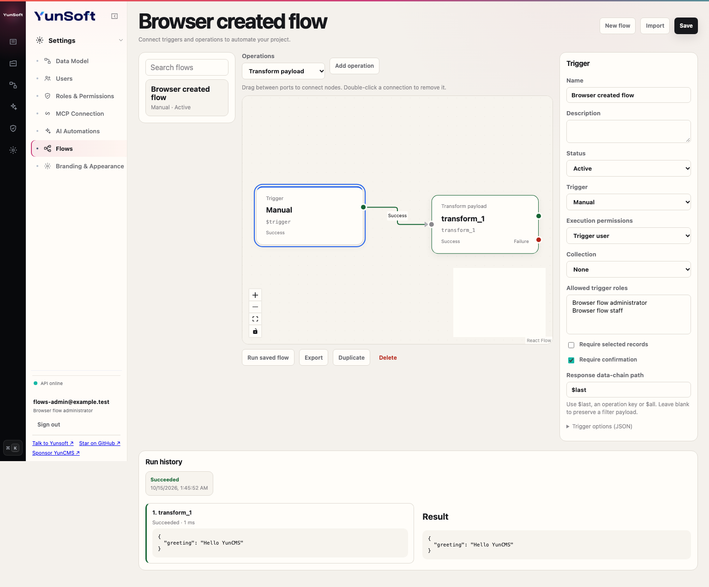

Start with [your first flow](#your-first-flow), then follow the [branching example](#connect-branches-and-merge-the-result). For complete downloadable definitions, prerequisites, API requests and expected outputs, use [Flow recipes](flows-recipes.md).

| Task | Guide |
| --- | --- |
| Learn the editor and create a working manual action | [Build and run a flow](#build-and-run-a-flow-in-studio) |
| Connect success/failure paths to a common result | [Branches and merging](#connect-branches-and-merge-the-result) |
| Run an action on selected Content records | [Content actions](#give-a-content-role-a-manual-action) |
| Configure event hooks, webhooks or UTC schedules | [Trigger setup](#configure-the-other-triggers) |
| Choose execution permissions and pass values | [Execution permissions](#execution-permissions), [Data chain](#data-chain-and-templates) |
| Configure one of the thirteen operation types | [Operation reference](#built-in-operations) |
| Integrate through HTTP or diagnose a failed run | [REST reference](#rest-reference-and-minimal-definition), [Troubleshooting](#troubleshooting) |

## Build and run a flow in Studio

1. Sign in as an Administrator and open **Settings → Flows** (`#/flows`).
2. Create a flow, name it and choose its trigger and execution permissions. New flows start **Inactive**.
3. Add operations. Drag nodes to arrange them and drag a connector from the trigger to the first operation.
4. Connect the green **Resolve** output for success or the red **Reject** output for failure to another operation's input. Multiple branches can connect to the same operation. Only the branch selected during this run executes; a merged node does not wait for other branches.
5. Select a node to edit its name, unique data-chain key and options. Most operation options use JSON; invalid JSON blocks saving. Run script uses a JavaScript editor and module-format selector. The collection selector fills the collection option for data operations.
6. Activate and save. **Run saved flow** executes a saved manual flow with the JSON input supplied in the shared confirmation dialog. Unsaved changes must be saved first.
7. Open a run in **Run history** to inspect its output and step trace. The canvas highlights successful and failed steps. A handled rejection can appear as a failed step inside a successful run.

Double-click a connection to remove it. Removing an operation clears its incoming connections and trigger entry. Circular connections are rejected. Use **Duplicate**, **Export** and **Import** to reuse definitions; imports and duplicates start inactive and get a new id when saved. Export contains the definition, not run history. Saving or deleting a stale revision returns `FLOW_REVISION_CONFLICT` (409); reload before continuing.

The editor uses Studio's shared components, typography, spacing, theme tokens and responsive layout. Settings access and flow definitions/history are restricted to Administrators. Ordinary authenticated users see only explicitly granted manual actions in the relevant Content collection list or record editor. Actions requiring selection stay disabled until records are selected. Confirmation is a Studio interaction; direct API callers must provide the same required collection/selection data but do not receive a browser dialog.

### Understand the editor

| Area | What to do |
| --- | --- |
| Flow list | Search saved flows or open a definition. **New flow** starts an empty draft. |
| Operations toolbar | Choose an operation type, then click **Add operation**. The new node becomes selected. |
| Canvas | Pan, zoom, drag operation nodes and draw connections between their ports. The trigger stays anchored. Layout coordinates are saved with the definition. |
| Inspector | Select the trigger to edit its name, activation, trigger type and execution permissions; select an operation to edit its key, type and JSON options or script source. |
| Graph actions | Run a saved active manual flow, export the current definition, duplicate it or delete the saved flow and its history. |
| Run history | Select a run to display its result and per-step status, output and duration. |

Studio's English UI labels the connectors **Success** and **Failure**. These correspond to the definition's `resolve` and `reject` fields. In Turkish they are **Başarılı** and **Başarısız**. Connector colors help orientation, while labels identify the branches.

### Your first flow

This example needs an Administrator account but no collection, external service or SMTP configuration.

1. Open **Settings → Flows → New flow**. Enter `Greeting` as the name. Keep **Manual** and **Trigger user** selected.
2. Choose **Transform payload**, click **Add operation**, name it `Build greeting` and set its key to `greeting`.
3. Enter the options below. The surrounding object is required; the field accepts JSON, not a JavaScript expression.

```json
{
  "value": {
    "message": "Hello {{ $trigger.body.name }}"
  }
}
```

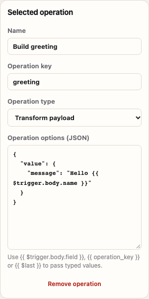

4. Drag the trigger's Success connector to the operation's input on the left. Select the trigger, set **Status → Active**, keep **Response data-chain path** as `$last` and click **Save**.
5. Click **Run saved flow** and enter the following trigger payload. The outer `body` is part of the manual input you supply.

```json
{ "body": { "name": "YunCMS" } }
```

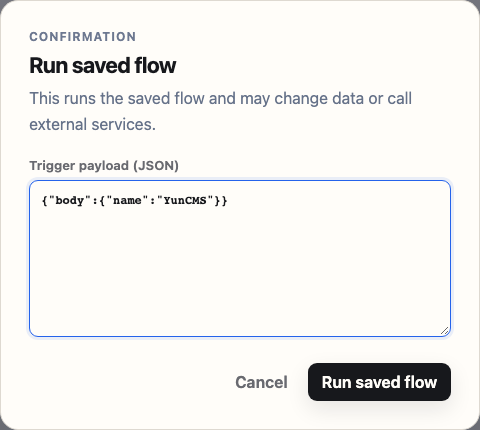

6. Confirm **Run saved flow**. The result is `{"message":"Hello YunCMS"}` and the run is **Succeeded**. To repeat the same example without assembling nodes, paste [manual-greeting.json](examples/flows/manual-greeting.json) into **Import**. Imports start inactive: inspect, activate and save before running.

The operation key is how later nodes reference a result (`{{ greeting.message }}`). Changing a key requires updating templates that reference it. A node id identifies graph connections; it is separate from the key and display name. Export includes all three plus node positions, options and connections.

### Connect branches and merge the result

Import [approval-branches.json](examples/flows/approval-branches.json). It contains a Condition, two Transform payload nodes and a final shared Transform payload node. Review the inactive graph, activate and save it.

```text
Trigger → Approval check ─Success→ Approved path ─┐
                        └Failure→ Review path ───┴→ Shared result
```

The condition options are `{"rules":{"$trigger.body.approved":{"_eq":true}}}`. Run first with `{"body":{"approved":true}}` and then with `{"body":{"approved":false}}`.

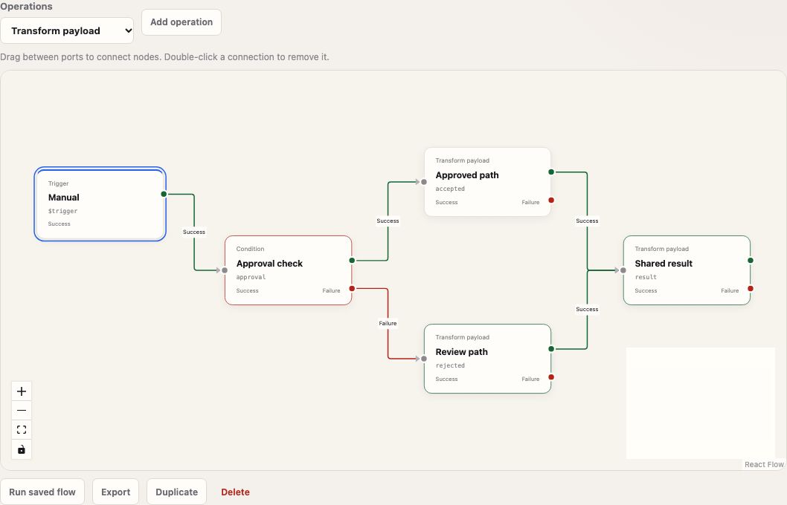

| Input | Executed keys | Output |
| --- | --- | --- |
| `approved: true` | `approval`, `accepted`, `result` | `{"decision":"approved","accepted":true}` |
| `approved: false` | `approval`, `rejected`, `result` | `{"decision":"needs_review","accepted":false}` |

Only one of the two middle nodes runs. Both can feed `result`, which receives the chosen node's result through `$last`. This is a convergence point, not parallel fan-out or a join that waits for multiple tasks. Loops cannot be drawn; use a child flow with an array payload for bounded iteration.

### Read the result and trace

After a run, click its history entry. Each executed node shows its key, duration, status and safe result. The canvas highlights executed nodes. Unvisited nodes have no run status.

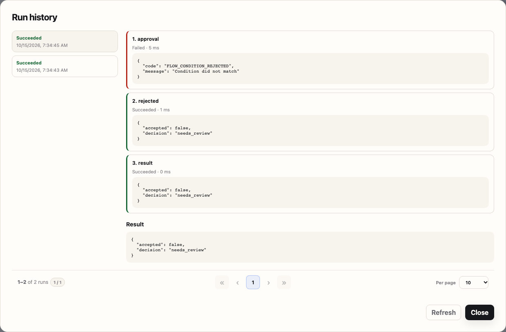

In the false-input example, `approval` is **Failed** with `FLOW_CONDITION_REJECTED`, but its Failure connector handles the rejection. The overall run therefore succeeds after `rejected` and `result`. Without that connector, the rejection ends the run and the API returns an error. A failure does not automatically follow a Success connector.

### Give a Content role a manual action

Use [manual-content-review.json](examples/flows/manual-content-review.json) to change selected article records to `status: "review"`.

1. Create a project collection `articles` with `title` and `status` string fields. Give an ordinary role read access to the records and read/update access to `status`. Native row filters still restrict which records it can change.
2. Import the definition. Select the trigger, choose your collection, select the ordinary role in **Allowed trigger roles**, and keep **Require selected records** and **Require confirmation** enabled. This replaces the example's role UUID placeholder.
3. Select the Update data node. Its collection must also be your collection; choosing a trigger collection does not change operation options. Keep `ids` as `"{{ $trigger.keys }}"` and the payload as `{"status":"review"}`.
4. Keep **Trigger user** execution permissions, activate and save. Sign in as the ordinary user, open the collection in **Content**, select a record and click **Mark for review**.

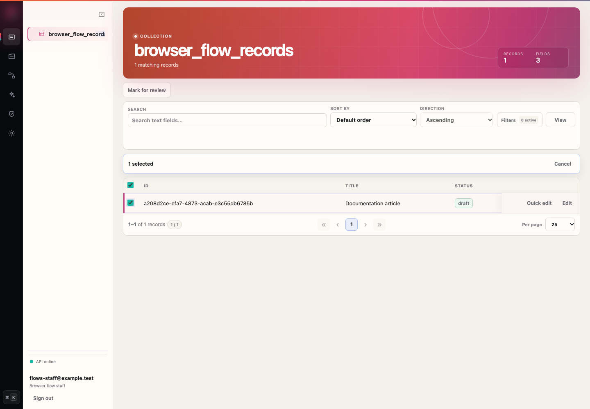

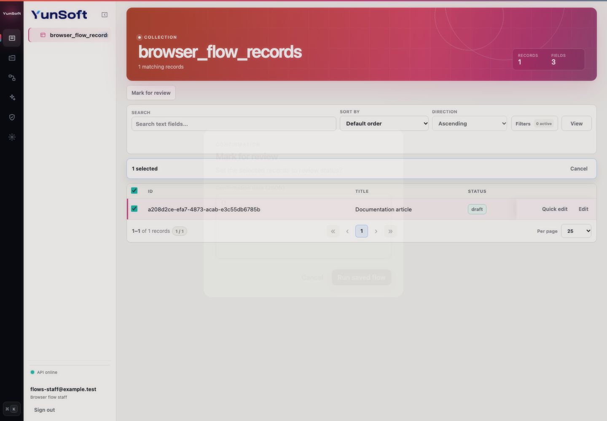

5. Confirm the action. Studio reloads the records and the selected record's status becomes `review`. Without selected records the action is disabled; without an allowed-role grant it is absent. Collection-scoped flows appear on the list and on existing-record editors, not on unsaved new records.

The screenshot uses a disposable `browser_flow_records` collection with the same `title`/`status` fields. Collection names, role ids and user ids must be chosen for your own project. No production records are needed to follow the example.

### Configure the other triggers

**Event hook.** Select the trigger and choose **Event hook**. Pick **Filter · before the write** for blocking validation or **Action · after commit** for queued follow-up work. Select a native event and collection. [event-title-required.json](examples/flows/event-title-required.json) rejects an article creation when the title is absent, null or empty. Keep its response path blank so a passing condition preserves the native payload.

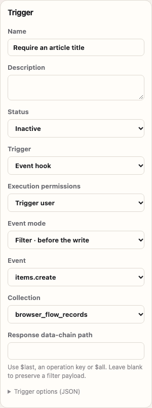

Use advanced trigger JSON to match several events or collections. The available event names differ between Filter and Action; see the [trigger reference](#triggers). A veto-only native event such as password-update admission can reject the mutation but does not allow a flow to replace credentials. Use the event's [native contract](extensions.md) when choosing payload paths.

**Webhook.** Import [webhook-greeting.json](examples/flows/webhook-greeting.json), review the **POST** method and private access, activate and save. The inspector shows its generated webhook URL. Send `{"name":"YunCMS"}` as the HTTP request body; the trigger supplies the `$trigger.body` wrapper automatically. This differs from manually supplying `{body: ...}` to a manual run.

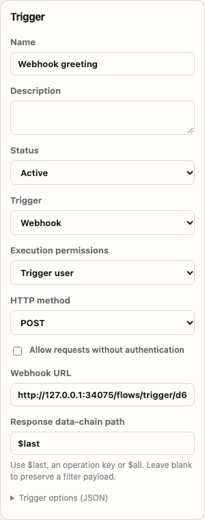

An unauthenticated request to this private example returns 403. Enabling **Allow requests without authentication** exposes the trigger; it does not choose execution permissions. See the [webhook recipe](flows-recipes.md#5-private-webhook) for exact requests and expected responses.

**Schedule.** Import [schedule-read.json](examples/flows/schedule-read.json). Choose an active ordinary **Run as** user with article-read permission and replace the operation's collection if needed. Keep it inactive while reviewing. The example reads at most 25 review records daily at **08:00 UTC**, using `0 0 8 * * *`. Activate and save to enable dispatch while the API is running.

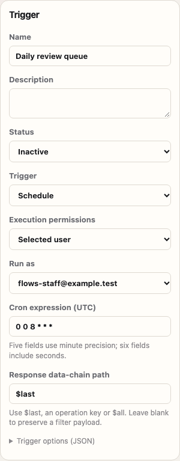

The editor's Run button is for manual flows. To try a scheduled graph immediately, duplicate it, switch the copy to Manual, review the trigger options and run the copy. Keep that test copy separate from the schedule. Schedule output is retained in run history; merely reading a review queue does not send a notification or change a record.

**Another flow.** Import [child-normalize.json](examples/flows/child-normalize.json), activate and save it. Import [parent-batch.json](examples/flows/parent-batch.json), replace its child-id placeholder with the saved child's id, then activate the parent. A child configured with **Another flow** cannot be executed through the manual-run endpoint. See [array iteration](flows-recipes.md#7-call-a-child-once-per-array-element) for the input and returned array.

### Mobile and dark appearance

The same controls, inspector and history are available in the responsive layout. Pan and zoom inside the canvas to inspect a larger graph. Studio appearance controls supply the dark palette; flows do not have separate page-local theme settings.

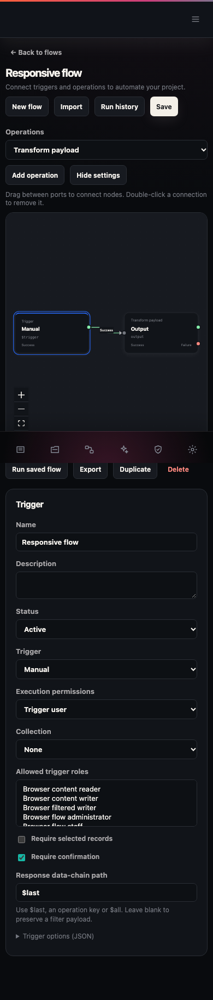

## Triggers

| Trigger | Options and behavior |
| --- | --- |
| `manual` | Run through Studio or `POST /flows/:id/run`. `collections` optionally restricts Content destinations; `allowed_roles` grants ordinary roles access. Administrators are allowed. `require_selection` requires a nonempty `keys` array; `require_confirmation` and optional `confirmation` control Studio's dialog. |
| `event` | Select `mode: "filter"` or `"action"`, `events` and `collections`. Filters run synchronously in the native mutation transaction; actions enqueue after commit. |
| `webhook` | `method: "GET"` or `"POST"`, default POST. Private by default and requires an Administrator. Set `public: true` explicitly to allow unauthenticated callers. URL: `/flows/trigger/:id`. Input has `body` and `query`; request headers and authorization credentials are not added to the data chain. |
| `schedule` | `cron` accepts five fields (minute/hour/day/month/weekday) or six fields (second first). UTC only. Supports `*`, numeric lists, ranges and steps on `*` or ranges. Weekday is 0–6; day and weekday restrictions both apply. `0 */5 * * * *` runs every five minutes. Choose explicit public, system or selected-user accountability. |
| `operation` | Invoked by another flow's `trigger` operation. No standalone public execution endpoint. An array payload invokes the child once per element, serially, and returns an array of outputs. |

Blocking events: `items.create`, `items.update`, `items.delete`, `users.update`, `users.delete`, `users.password.update`. Action events additionally include `users.create`, `files.create`, `files.update`, `files.delete`. Match the native collection name, including `yuncms_users`/`yuncms_files` when relevant; the advanced trigger JSON accepts multiple events and collections. Studio's basic collection picker lists project collections.

Event input is `{event, collection, key, payload}` for filters and `{event, collection, payload}` for actions. Payload shapes follow the [native hook contracts](extensions.md). A filter leaves the native payload unchanged unless `options.response` names the replacement data-chain result. Native validation and permission rules still run after a filter returns. An unhandled error rolls back the mutation and any flow data writes on that transaction. Run history for that transaction rolls back too. External HTTP or email side effects cannot be rolled back; use action flows for those effects.

## Execution permissions

Every definition explicitly selects an `accountability`:

- `trigger` (default): re-resolve the verified trigger user's current role and active status. A queued event retains the verified actor, not authority from the submitted payload.
- `public`: use current Public role permissions.
- `user`: set `run_as` to an active, ordinary, non-Public, non-Administrator user UUID. The user's current permissions are checked again at execution.
- `system`: explicit internal authority, selected only by an Administrator configuring the flow.

Permission to start a manual flow does not itself grant data access. CRUD nodes call native `ItemsService` with the chosen accountability, including field allowlists, row filters, validation, hooks and audit behavior. Data operations support project collections; they cannot perform generic CRUD on system collections. An intentionally privileged public webhook or manual action can perform privileged work: review both its trigger access and execution permissions before activating it.

## Data chain and templates

The chain contains `$trigger`, `$accountability` (user/role/admin/public/system), `$env`, `$last` and each operation's unique key. `$last` is the last result or safe error object. Use dot paths or numeric array indices: `{{ $trigger.keys[0] }}` or `{{ read_records.0.id }}`.

An entire template preserves JSON types: `"{{ $trigger.keys }}"` becomes an array. A template inside text becomes text: `"Hello {{ $trigger.body.name }}"`. Missing variables fail with `FLOW_VARIABLE_NOT_FOUND`. Prototype traversal is rejected. Templates access data paths; they do not evaluate JavaScript.

Trigger option `response` selects the output path (for example `$last` or `result.message`); `$all` returns the complete chain. No response option returns `$last`. For filters, leave `response` unset unless replacing the native payload deliberately.

`$env` is empty by default. Only server variables named in `FLOWS_ENV_ALLOW_LIST` are exposed. Allowlisted values can reach outputs or destinations selected by a flow; do not allowlist secrets unintentionally.

## Built-in operations

Options accept templates except script source, which is executed literally. The following JSON objects are operation **options**, not complete definitions.

| Type | Options/example | Result |
| --- | --- | --- |
| `script` | `{"format":"module","code":"export default data => data.$trigger.body"}` | JSON return value from trusted JavaScript; opt-in server execution, including installed Node/npm modules. See [Run script](#run-script). |
| `transform` | `{"value":{"name":"{{ $trigger.body.name }}"}}` | JSON value. |
| `condition` | `{"rules":{"$trigger.body.approved":{"_eq":true}}}` | Resolve on match, reject otherwise. Optional `value` supplies an object to test instead of the chain. Missing fields do not match. Supports `_and`, `_or`, `_eq`, `_neq`, `_null`, `_nnull`, `_gt`, `_gte`, `_lt`, `_lte`, `_in`, `_nin`, `_contains`, `_starts_with`, `_ends_with`. |
| `read` | `{"collection":"articles","query":{"fields":["id","title"],"limit":10}}` | Native item array. Optional `ids` reads specific ids; reads are bounded to 100 items. Uses the native [query language](api-query-language.md). |
| `create` | `{"collection":"articles","payload":{"title":"Example"}}` | Created item array. `payload` can contain 1–100 objects. |
| `update` | `{"collection":"articles","ids":"{{ $trigger.keys }}","payload":{"status":"review"}}` | Updated item results, in id order. Requires 1–100 ids. |
| `delete` | `{"collection":"articles","ids":"{{ $trigger.keys }}"}` | Native delete results, in id order. Requires 1–100 ids. |
| `log` | `{"message":"{{ $last }}"}` | Redacted structured application log; result `null`. |
| `sleep` | `{"milliseconds":1000}` | Delay 0–5000 ms; result `null`. |
| `request` | `{"method":"POST","url":"https://api.example.test/task","headers":{},"body":{"id":"{{ $trigger.keys[0] }}"}}` | `{status, body}`. HTTP(S) only, explicit server hostname allowlist, no URL credentials or redirects. GET/POST/PUT/PATCH/DELETE/HEAD; non-2xx fails. JSON response content types are decoded; otherwise body is text. Maximum response 256 KiB; HEAD/empty responses return an empty string. |
| `mail` | `{"to":"reader@example.test","subject":"Updated","text":"Record changed"}` | Native SMTP delivery; `to` may contain up to 20 recipients. Requires [SMTP configuration](configuration.md#smtp-and-account-actions). Result `null`. |
| `trigger` | `{"flow":"CHILD_FLOW_UUID","payload":"{{ $last }}"}` | Child flow output, or outputs for an array of up to 100 inputs. The child must use the `operation` trigger. |
| `error` | `{"code":"REVIEW_REQUIRED","status":422,"message":"Review this record first"}` | Throws a configured 4xx error. Code uses uppercase letters, numbers and underscores. A reject connection may handle it. |

CRUD option `emit_events` defaults to `false`. It suppresses additional **Flow** event dispatch from that operation while native extension guards, audit and transaction behavior remain active. Setting it to `true` enables other matching flows; ancestry tracking still prevents recursive flow loops. Multi-item updates/deletes follow native per-item transaction behavior unless already inside a blocking filter transaction; do not assume a whole manual graph is one atomic transaction.

## Run script

**Run script executes trusted server code. It is disabled by default.** An Administrator with permission to edit a script can access the API process's filesystem, environment, network and installed packages. Separate processes and deadlines contain ordinary crashes and CPU loops; they are **not a security sandbox**. Enable this only when all Flow administrators are trusted to run server code. The Request node's hostname allowlist and `$env` allowlist do not restrict arbitrary Node imports, `process.env` or a script's own network calls.

Set `FLOWS_SCRIPTS_ENABLED=true` in the running project's environment and restart the API. Inactive script definitions can be saved and reviewed while execution is disabled; activating one returns `FLOW_SCRIPT_DISABLED` until enabled. The inspector shows the current server setting. Choose **Run script**, select **ES module** or **CommonJS**, and enter JavaScript in its shared code field.

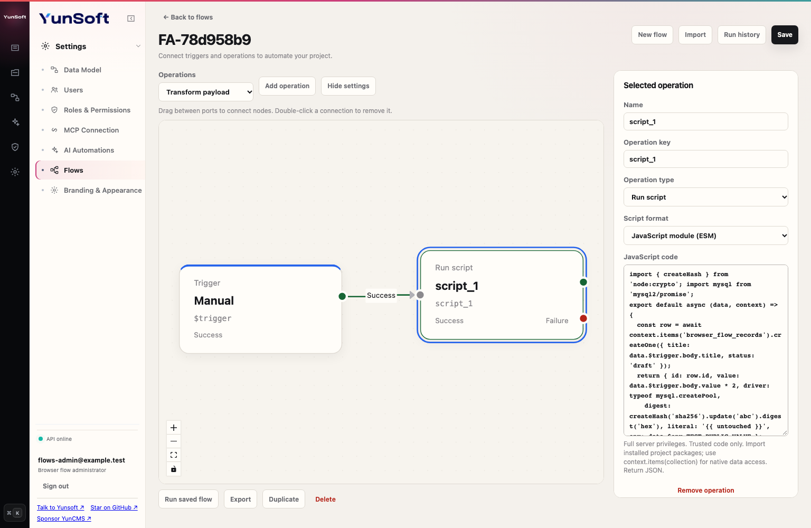

ES modules export one default function. Its first argument is the complete data chain, not only the trigger body. Code is executed literally: `{{ ... }}` is not interpolated inside source. Return a JSON value for the node's result:

```js
import { createHash } from 'node:crypto';
import { ExtensionError } from '@yunsoft/yuncms-extensions-sdk';

export default async function (data, context) {
  const title = data.$trigger.body?.title;
  if (typeof title !== 'string' || !title.trim()) {
    throw new ExtensionError('TITLE_REQUIRED', 'Supply a title', { status: 422 });
  }
  const item = await context.items('articles').createOne({ title, status: 'review' });
  return { id: item.id, fingerprint: createHash('sha256').update(title).digest('hex') };
}
```

For CommonJS choose `format: "commonjs"` and use `module.exports = async function (data, context) { ... }`. `require('node:crypto')` and installed npm packages work in that format. ESM supports static and dynamic `import`. Install dependencies in the **running project's** `node_modules` with npm, include them in the deployment/image, and restart/redeploy when required. YunCMS does not install packages from script source or infer dependencies from flow imports. Packages must support Node.js 24 and the selected module format. Relative imports resolve from the temporary script directory; use installed packages for reusable code. Exporting a non-function fails with `FLOW_SCRIPT_EXPORT_INVALID`.

In the official Docker image, the running project directory is `/data`. Manage its package manifest/lockfile and install project dependencies under `/data/node_modules`. The runtime user needs write access to the private `/data/.yuncms/flow-scripts` directory. Deploy the same dependency versions to every API replica.

| Context member | Contract |
| --- | --- |
| `accountability` | Verified execution actor selected by the flow; input cannot replace it. |
| `requestId` | Verified request id, or null for work with no originating request. |
| `env` | The same allowlisted values as `$env`. This is a convenience, not a restriction on trusted Node code. |
| `log(value)` and `console.log/info/warn/error/debug` | Redacted structured application logging. Avoid secrets in arbitrary strings. |
| `items(collection, {emit_events: false})` | Native project-collection service proxy: `readOne(id, query?)`, `readMany(query?)`, `createOne(payload)`, `createMany(payloads)`, `updateOne(id, payload)`, `deleteOne(id)`. |

The native proxy runs services directly with the flow's current accountability, schema, original transaction and native guards. It preserves read/write field masks, row filters and validation. Generic system-collection access is rejected. `readMany` returns at most 100 records; `createMany` accepts 1–100. A script may issue 100 native calls with at most 16 outstanding at once. Calls already admitted are drained before completion/rollback; await your calls and return only after the intended work is complete. Additional **Flow** events are suppressed by default; `emit_events: true` enables them with ancestry protection. Native extension hooks and audits remain active. In a blocking event, a failed script rolls back both the original write and native proxy writes; filesystem, direct package/SQL and network side effects are outside that transaction. Use the native proxy rather than raw drivers when permission/transaction guarantees are needed.

Source is limited to 64 KiB and input/output to the graph's 256 KiB JSON limit. `undefined` becomes null, BigInt values become decimal strings, and circular/non-JSON output fails. The Failure connection can handle script errors. Syntax errors, missing dependencies and thrown exceptions (including null/string values) are recorded as failed nodes. Error codes/messages and custom 4xx statuses are propagated; use the SDK's `ExtensionError` for explicit validation. Scripts run once per invocation; failures do not trigger automatic retry.

Defaults are **5 seconds**, **128 MiB main V8 heap**, and **2 concurrent scripts per API process**. Configure `FLOWS_SCRIPT_TIMEOUT_MS` (100–30000), `FLOWS_SCRIPT_MEMORY_MB` (32–512), and `FLOWS_SCRIPT_CONCURRENCY` (1–8). The heap limit is not a total OS-memory limit: buffers, native libraries, worker threads and child processes need additional memory. The graph's 30-second deadline also applies. A timeout kills the script process group on POSIX; an independent watchdog also terminates ordinary orphaned scripts if the API parent disappears. These controls are not protection against deliberately hostile server code. Windows terminates the script process; descendant-process cleanup is not guaranteed there.

Use [order calculation](flows-recipes.md#8-calculate-an-order-in-a-trusted-script) and [CommonJS imports](flows-recipes.md#9-use-an-installed-package-from-commonjs) for complete importable examples. Keep credentials outside source and exported definitions.

## REST reference and minimal definition

| Method/path | Access and result |
| --- | --- |
| `GET /flows` | Administrator; newest definitions first, up to 500. |
| `GET /flows/configuration` | Administrator; project collections, roles, eligible users, operation/event catalogue and bounds. |
| `POST /flows` | Administrator; create definition, returns 201 with id/revision. |
| `GET /flows/:id` | Administrator; complete definition. |
| `PUT /flows/:id` | Administrator; replace definition, include current `revision`. |
| `DELETE /flows/:id?revision=1` | Administrator; delete graph and its history, returns 204. |
| `GET /flows/:id/runs` | Administrator; newest 50 runs with safe input, actor, trace and output. |
| `GET /flows/available?collection=articles` | Authenticated; allowed active manual actions with display/confirmation/selection metadata, without graph definitions. |
| `POST /flows/:id/run` | Allowed manual caller; arbitrary JSON object, commonly `{collection, keys, body}`. Returns `{id,status,output,trace}` inside `data`. |
| `GET`/`POST /flows/trigger/:id` | Matching webhook method/access; returns the same execution envelope. |

Example `POST /flows` body:

```json
{
  "name": "Greeting",
  "status": "active",
  "trigger": "manual",
  "accountability": "trigger",
  "options": { "response": "$last", "require_confirmation": true },
  "entry": "greeting",
  "operations": [{
    "id": "greeting", "key": "greeting", "name": "Build greeting",
    "type": "transform", "position": { "x": 380, "y": 100 },
    "options": { "value": { "message": "Hello {{ $trigger.body.name }}" } },
    "resolve": null, "reject": null
  }]
}
```

Run with `POST /flows/FLOW_UUID/run` and `{"body":{"name":"YunCMS"}}`. The output is `{"message":"Hello YunCMS"}`. The definition has no ordinary-role grant, so only Administrators can run this example.

## Queue, schedules and bounds

Action and scheduled runs persist in MySQL. Each API process polls schedules independently and runs one queued job at a time. Schedule checks continue while a job is running. Row locks with `SKIP LOCKED` prevent replicas from claiming the same job. A unique flow/UTC-second key deduplicates scheduled dispatch between replicas. Scheduling is best effort while the API is running; there is no downtime catch-up or hard real-time guarantee.

Queued jobs pin the definition revision. Editing or deactivating a flow skips pending work with `FLOW_DEFINITION_CHANGED`. Queue capacity is 1000 pending/running jobs per flow. Running jobs have a one-minute lease; a worker detects expired leases as `FLOW_RUN_INTERRUPTED`. Interrupted jobs are not automatically retried, avoiding duplicate external side effects. Retained history has no automatic cleanup; deleting a flow removes its runs. Pending jobs retain their input to execute correctly, so secure database access/backups; input is redacted when claimed and in the history API.

Definitions and data chains are limited to 256 KiB, 100 nodes, 100 steps per graph, eight nested levels, 100 child inputs and 500 steps across a nested execution tree. JSON nesting is limited to 32 levels. A graph has a 30-second cooperative deadline shared with child execution: HTTP and delay operations observe cancellation; native database work already in progress cannot be undone solely by a timer. Completion after the deadline fails with `FLOW_TIMEOUT` (504).

Run history redacts sensitive key names using the native audit redactor and bounds each stored value to 64 KiB. Redaction is not detection of secrets embedded in arbitrary text. Avoid embedding credentials in definitions, arbitrary messages, non-secret field names or exported JSON.

Trusted server code can also supply an `operations` Map to `FlowsService` for additional operation types. Custom operations must honor the supplied deadline and native service boundaries. Internal callers use services directly, not YunCMS HTTP endpoints.

## Troubleshooting

| Symptom/code | Check |
| --- | --- |
| **Run saved flow** is disabled | The flow must be saved, active, Manual and have no unsaved changes. Other trigger types run through their trigger. |
| Save is disabled after editing options | Correct the invalid JSON or choose an operation/trigger deliberately to return to its last valid options. Strings require double quotes; trailing commas are invalid. |
| `INVALID_FLOW` | Check required names, unique keys/ids, a connected trigger entry, existing connection targets, valid trigger options and operation bounds. |
| `FLOW_VARIABLE_NOT_FOUND` | Inspect the actual trigger input and prior node keys. Manual API input is the supplied object; webhook input contains `body`/`query`; event input contains `payload`. A typo or a path to a node that did not run has no value. |
| `FLOW_REVISION_CONFLICT` | Another save changed the graph. Preserve any draft export, reload the current definition and reapply your change. |
| Content action is absent or disabled | Check active Manual trigger, collection, role grant, authenticated user and required record selection. The role must also have native permissions for the data operation. |
| `FORBIDDEN` / `FORBIDDEN_FIELD` | Check the selected execution user, its current role, field allowlist and row filter. Starting an action does not bypass item authorization. |
| `FLOW_ACTOR_UNAVAILABLE` | The selected/trigger user must still be active and have an allowed current role. Choose an eligible normal Run as user. |
| `FLOW_REQUEST_FORBIDDEN` | Add the exact intended hostname to `FLOWS_REQUEST_ALLOWED_HOSTS` and restart. Empty is deny-all; wildcards and URLs are not hostnames. |
| `FLOW_REQUEST_REDIRECT` / `FLOW_REQUEST_FAILED` | Requests do not follow 3xx redirects and reject non-2xx responses. Use the final intended URL and inspect the external service separately. |
| `FLOW_SCRIPT_DISABLED` | Enable `FLOWS_SCRIPTS_ENABLED=true` and restart before activating a script flow. Inactive definitions can be edited while disabled. |
| `FLOW_SCRIPT_BUSY` / `FLOW_SCRIPT_TIMEOUT` / `FLOW_SCRIPT_EXIT` | Inspect script concurrency, deadline and process failure. A failed run can follow its Failure connector; work is never automatically retried. |
| `ERR_MODULE_NOT_FOUND` / `MODULE_NOT_FOUND` / `FLOW_SCRIPT_EXPORT_INVALID` | Install the dependency in the running project, rebuild the deployment if needed, and export a function in the chosen module format. |
| `MAIL_NOT_CONFIGURED` | Configure SMTP and restart before using Send email. Test with a controlled recipient or test transport. |
| `FLOW_TIMEOUT` / `FLOW_STEP_LIMIT` / `FLOW_RECURSION_LIMIT` | Reduce work, split the graph or reduce child inputs. Do not create a recursive child/event loop. |
| Pending run becomes **Skipped** | Its definition was edited or deactivated before it was claimed; the queued revision is no longer current. |
| Scheduled run is missing | Confirm active status, UTC cron, a running API and its logs. There is no downtime catch-up. A five-field expression matches only at second zero. |
| Failed filter has no retained run | Filter history shares the original transaction and rolls back with a veto. Check the request's safe error code and server logs. |

Downloadable examples and the screenshots in this guide use synthetic data. Capture dates and scenario files are recorded in the [screenshot manifest](assets/screenshots/manifest.json); the original capture information for older Studio images is retained.

The trigger/data-chain/resolve-reject behavior was studied in the [Directus Flows documentation](https://directus.com/docs/guides/flows/), [trigger guide](https://directus.com/docs/guides/flows/triggers) and [data-chain guide](https://directus.com/docs/guides/flows/data-chain). YunCMS implements its own bounded service and graph contracts; definitions are not a Directus import format.

## Validate a deployment before enabling flows

Use a separate disposable MySQL database whose name contains `test`, `ci` or `dev`. Never point acceptance fixtures at production. Set the normal `DB_*` connection variables, `YUNCMS_TEST_MYSQL=1`, and `YUNCMS_TEST_DB_ALLOW_DESTRUCTIVE=1`, then run `npm run test:flows` from the source checkout. This command builds Studio and sequentially runs pure unit/source checks, actual Node script processes, real MySQL/API integration and Chromium Playwright. It fails on skipped, cancelled or failing tests; reports and logs are local under `.yuncms/flows-tests/acceptance/`. Chromium must already be installed (`npx playwright install chromium`). To run the same scenarios in all three engines, install them with `npx playwright install chromium firefox webkit` and set `YUNCMS_BROWSER_ENGINES=chromium,firefox,webkit`; the default is `chromium`. Node.js 24 and `openssl` are required for the real TLS fixtures. Browser cases allow 120 seconds including browser/context startup; UI assertions remain bounded to 8 seconds. Cases that intentionally wait for a native deadline or worker lease declare a larger total budget. Tests run serially with zero retries.

The suite creates synthetic users/collections/flows, runs real HTTPS with trusted and untrusted certificates, sends SMTP to a local TCP server, polls actual UTC time, executes imports, checks native authorization/transaction rollback, competes with two real workers, holds an unexpired job row in a real transaction while another dispatcher polls, kills a worker and waits for its real one-minute lease, and checks script crashes/timeouts/heap limits. Network fixtures bind only to localhost. No database, HTTP/HTTPS, SMTP, script process, scheduler clock or browser request is mocked. Existing unrelated legacy repository suites retain their own coverage. These checks do not validate your production credentials, external provider availability, replica sizing or business-specific scripts; repeat the relevant scenarios with controlled integrations before activation.
